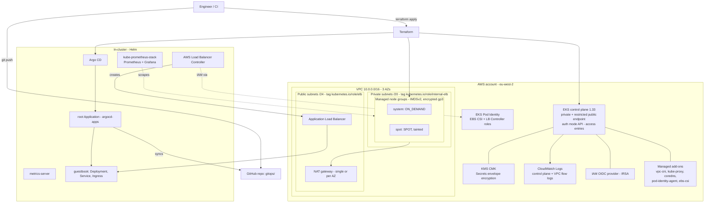

# terraform-aws-eks-platform


## In plain English

This builds a private Kubernetes cluster on AWS (Amazon EKS) and the standard tools a platform team installs on day one. Once it is up, you change what runs on the cluster by committing YAML to Git, and Argo CD applies it for you. Prometheus and Grafana show how the cluster is behaving, and the AWS Load Balancer Controller turns a Kubernetes Ingress into a real AWS load balancer. Everything is tested offline for free, and there is a local `kind` lab so you can practise the GitOps part without an AWS bill.

## Architecture



## What it demonstrates

- EKS built from raw `aws_*` resources (no community EKS module), so every security setting is visible and tested.
- Modern EKS access: `authentication_mode = "API"` with access entries instead of the `aws-auth` ConfigMap.
- Workload IAM with EKS Pod Identity (EBS CSI driver, Load Balancer Controller), plus an IRSA OIDC provider for older charts.
- Node hardening: launch templates enforcing IMDSv2 and encrypted gp3 root volumes, SSM access instead of SSH.
- GitOps: Argo CD bootstrapped by Terraform with an app-of-apps root Application pointing at this repo.
- Observability: kube-prometheus-stack with a generated Grafana password stored as a Kubernetes Secret.
- Offline testing: `terraform test` with mocked `aws`, `helm`, `kubernetes`, `tls` and `random` providers; tflint and checkov in CI.
- Cost awareness: single NAT toggle, Spot node group, `STANDARD` upgrade policy to avoid the extended-support surcharge.

## Features

| Area | Feature |
|---|---|
| Network | 3 AZs, private `/20`s and public `/24`s via `cidrsubnet`, ELB discovery tags, single or per-AZ NAT, default SG locked down, KMS-encrypted flow logs |
| Control plane | Kubernetes `1.33` (variable), private endpoint on, public endpoint toggle restricted to `public_access_cidrs` (rejects `0.0.0.0/0`), all five log types to an encrypted log group |
| Encryption | Customer-managed KMS key with rotation for Secrets and control plane logs |
| Access | API-only auth mode, `aws_eks_access_entry` + `AmazonEKSClusterAdminPolicy` for each ARN in `admin_principal_arns` |
| Nodes | Map of managed node groups: instance types, `ON_DEMAND`/`SPOT`, min/max/desired, labels, taints; IMDSv2 required, hop limit 2, encrypted gp3 |
| Node IAM | `AmazonEKSWorkerNodePolicy`, `AmazonEKS_CNI_Policy`, `AmazonEC2ContainerRegistryReadOnly`, `AmazonSSMManagedInstanceCore` |
| Managed add-ons | vpc-cni, kube-proxy, eks-pod-identity-agent (before nodes), coredns, aws-ebs-csi-driver with Pod Identity (after nodes) |
| IRSA | `aws_iam_openid_connect_provider` with the thumbprint from `data "tls_certificate"` |
| Platform add-ons | Toggles and pinned chart versions for Argo CD, argocd-apps root app, kube-prometheus-stack, metrics-server, AWS Load Balancer Controller |
| GitOps | `gitops/bootstrap` (child Applications) and `gitops/apps/guestbook` (Kustomize: Deployment, Service, ALB Ingress) |
| Free lab | `local/` kind cluster + `make kind-up` installs Argo CD and the same root app |

## Quick start

### Free path (no AWS account needed)

```bash
cd examples/complete
terraform init -backend=false
terraform validate
terraform test          # 10 runs, all providers mocked
```

Or from the repo root: `make all` (fmt, validate, tflint, test, checkov).

### Free local lab (kind)

Requires Docker, [kind](https://kind.sigs.k8s.io/), `kubectl` and `helm`.

```bash
make kind-up            # kind cluster + Argo CD (pinned chart) + root app-of-apps
make kind-argocd-ui     # http://localhost:8080, user admin, password printed by kind-up
make kind-down
```

Argo CD syncs `gitops/bootstrap` and then the guestbook app from GitHub. The Ingress has no `alb` controller on kind, so it stays without an address; use `kubectl -n guestbook port-forward svc/guestbook 8081:80` instead.

### Real deploy (costs money)

> This creates billable resources (roughly 0.30 to 0.35 USD an hour with the defaults, see below). Run `terraform destroy` as soon as you are finished.

```bash
cd examples/complete
cp terraform.tfvars.example terraform.tfvars   # set public_access_cidrs to your IP/32 and your admin role ARN
terraform init

# Two-stage apply: the helm/kubernetes providers need a running cluster.
terraform apply -target=module.network -target=module.eks_cluster
terraform apply

$(terraform output -raw kubeconfig_command)
kubectl get nodes
$(terraform output -raw argocd_port_forward_command)
```

The `helm` and `kubernetes` providers are configured from the cluster module's outputs and authenticate with `exec` running `aws eks get-token`, so no long-lived token is stored in state. Terraform cannot configure a provider from a resource that does not exist yet, which is why the first apply is targeted. **In production you would split this into two root modules with separate state** (cluster, then add-ons reading the cluster through `data "aws_eks_cluster"`), so an add-on change can never plan a cluster replacement and each layer has its own blast radius.

Teardown:

```bash
kubectl delete ingress -A --all    # let the controller delete the ALB first
terraform destroy
```

## Cost estimate

Approximate, on-demand, eu-west-2, not verified against current AWS pricing — check the [AWS Pricing Calculator](https://calculator.aws/).

| Item | Default quantity | Approx. USD / month |
|---|---|---|
| EKS control plane (standard support) | 1 cluster | 73 |
| EC2 `t3.medium` on-demand (system pool) | 2 | 69 |
| EC2 `t3.large` Spot (spot pool) | 1 | 20-25 |
| NAT gateway (hourly, excl. data) | 1 (`single_nat_gateway = true`) | 36 |
| Application Load Balancer (guestbook Ingress) | 1 | 19 + LCUs |
| EBS gp3 root volumes 30 GiB | 3 | 8 |
| Public IPv4 addresses (NAT EIP, ALB) | ~3 | 11 |
| KMS customer-managed keys | 2 | 2 |
| CloudWatch Logs (control plane + flow logs) | varies | 5-20 |
| **Total** | | **~245-265 (about 0.35 USD/hour)** |

Setting `single_nat_gateway = false` adds two more NAT gateways (~72). Always run `terraform destroy` when you finish a lab session.

## Design decisions

| Decision | Why | Trade-off |
|---|---|---|
| Raw `aws_eks_*` resources instead of the community module | Every control is explicit, reviewable and unit-tested | More code to maintain than a one-line module call |
| `authentication_mode = "API"` | Access is IAM-managed via Terraform; no `aws-auth` ConfigMap drift | Requires EKS access entries support (all current versions) |
| EKS Pod Identity for add-on IAM | No OIDC trust policy per role; roles are reusable across clusters | Some third-party charts still expect IRSA, so the OIDC provider is kept too |
| `bootstrap_self_managed_addons = false` + managed add-ons | One owner (EKS add-ons API) for CNI, kube-proxy and CoreDNS | Node groups must wait for vpc-cni; ordering is encoded with `depends_on` |
| IMDSv2 required, hop limit 2 | Blocks IMDSv1 credential theft; hop 2 is the EKS-recommended value for containerised agents | Pods could reach node credentials; mitigated by using Pod Identity for workloads |
| Single NAT gateway by default | Saves ~72 USD a month in a lab | An AZ failure breaks egress for the other AZs |
| Argo CD bootstrapped with the `argocd-apps` chart | Avoids `kubernetes_manifest`, which needs the CRD at plan time and fails on a fresh cluster | Root Application lives in a Helm release rather than plain YAML |
| One root module in the example | Easy to read and test in one place | Production should split cluster and add-ons into separate state (see Quick start) |
| `upgrade_policy = STANDARD` | Avoids the extended-support surcharge on old versions | Forces upgrades at end of standard support |

## Testing & CI

| Check | What it does |
|---|---|
| `terraform fmt -check -recursive` | Consistent formatting |
| `terraform validate` | Schema and reference checks against the real provider schemas |
| `terraform test` (`examples/complete/tests`) | 10 plan-only runs with mocked providers: CIDR maths, ELB tags, NAT toggle, node group config, IMDSv2, encrypted gp3, Secrets encryption, API auth mode, access entries, Pod Identity, add-on toggles changing `helm_release` counts, and validation rejecting `capacity_type = "FOO"` and `0.0.0.0/0` |
| `tflint --recursive` | Terraform recommended preset plus the AWS ruleset (invalid instance types, deprecated args) |
| `checkov` | Static security analysis of all Terraform; 0 failed checks |

The GitHub Actions workflow (`.github/workflows/ci.yml`) runs these three jobs on every push to `main` and every pull request with `contents: read` permissions. Pre-commit hooks run the same checks locally.

## Security

- Secrets envelope encryption with a rotating customer-managed KMS key; control plane and flow log groups encrypted with CMKs.
- All five control plane log types enabled, one-year retention by default.
- Private API endpoint on; public endpoint restricted to a CIDR allow-list that rejects `0.0.0.0/0`.
- API-only cluster authentication through access entries; cluster creator admin can be switched off.
- Nodes in private subnets only, IMDSv2 required, encrypted root volumes, no SSH key or open port (SSM Session Manager instead).
- IAM roles built with `aws_iam_policy_document`; Pod Identity trust policies pinned with `aws:SourceAccount`.
- Load Balancer Controller policy tightened from upstream: listener and rule actions scoped to load balancer ARNs, security group writes scoped to `security-group/*` ARNs, WAF association limited to controller-tagged resources, classic `waf-regional` and Shield create/delete removed.
- Default VPC security group has no rules; Grafana uses a generated admin password, not the chart default.
- Demo workload runs as non-root with a read-only root filesystem, all capabilities dropped and `RuntimeDefault` seccomp.

Checkov exceptions (each with a justification next to the code):

| Check | Where | Why |
|---|---|---|
| `CKV_AWS_394` | `.checkov.yaml` | AZ names sort alphabetically and new AZs get later letters, so `slice(names, 0, n)` is stable; pinning names would hard-code a region into a reusable module |
| `CKV_AWS_39` | `aws_eks_cluster.this` (inline) | Public endpoint is an intentional, CIDR-restricted toggle for the lab; disable for production |
| `CKV_AWS_341` | `aws_launch_template.node` (inline) | Hop limit 2 is the EKS-recommended value; IMDSv2 tokens are still required |
| `CKV_AWS_109`, `CKV_AWS_111`, `CKV_AWS_356` | KMS key policy documents (inline) | In a key policy `"*"` means "this key"; key policies cannot reference their own ARN |

## Module reference

| Module | Purpose |
|---|---|
| [`modules/network`](modules/network/README.md) | VPC, subnets, NAT, flow logs |
| [`modules/eks-cluster`](modules/eks-cluster/README.md) | EKS control plane, node groups, add-ons, access entries, IRSA |
| [`modules/platform-addons`](modules/platform-addons/README.md) | Argo CD, GitOps bootstrap, monitoring, metrics-server, Load Balancer Controller |

Deeper notes: [docs/ARCHITECTURE.md](docs/ARCHITECTURE.md) and [docs/RUNBOOK.md](docs/RUNBOOK.md).

## Roadmap / Production hardening

- Split cluster and add-ons into separate root modules and remote state (S3 + native lockfile, see terraform-aws-state-bootstrap).
- Disable the public endpoint and reach the API through a VPN, bastion or SSM port-forward.
- Karpenter for node autoscaling and Spot diversification.
- External Secrets Operator with AWS Secrets Manager; cert-manager and ExternalDNS with an ACM certificate and HTTPS-only ALB.
- Persistent gp3 storage and Thanos or Amazon Managed Prometheus for long-term metrics.
- Argo CD SSO, AppProjects per team, and Kyverno or Gatekeeper admission policies.
- Network policies through the VPC CNI and VPC endpoints (ECR, S3, STS) to reduce NAT traffic.

## Related repos

- [terraform-aws-state-bootstrap](https://github.com/mhkhan01/terraform-aws-state-bootstrap)
- [terraform-aws-vpc-foundation](https://github.com/mhkhan01/terraform-aws-vpc-foundation)
- [terraform-aws-ecs-fargate-platform](https://github.com/mhkhan01/terraform-aws-ecs-fargate-platform)
- [terraform-aws-eks-platform](https://github.com/mhkhan01/terraform-aws-eks-platform) (this repo)
- [terraform-aws-serverless-api](https://github.com/mhkhan01/terraform-aws-serverless-api)
- [terraform-aws-static-site](https://github.com/mhkhan01/terraform-aws-static-site)
- [terraform-aws-security-baseline](https://github.com/mhkhan01/terraform-aws-security-baseline)

## Author

Mohammed Haris Khan, Cloud Engineer, Birmingham UK. [GitHub @mhkhan01](https://github.com/mhkhan01) · [LinkedIn](https://www.linkedin.com/in/mohammed-haris-khan)
