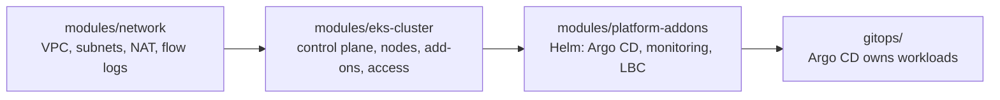
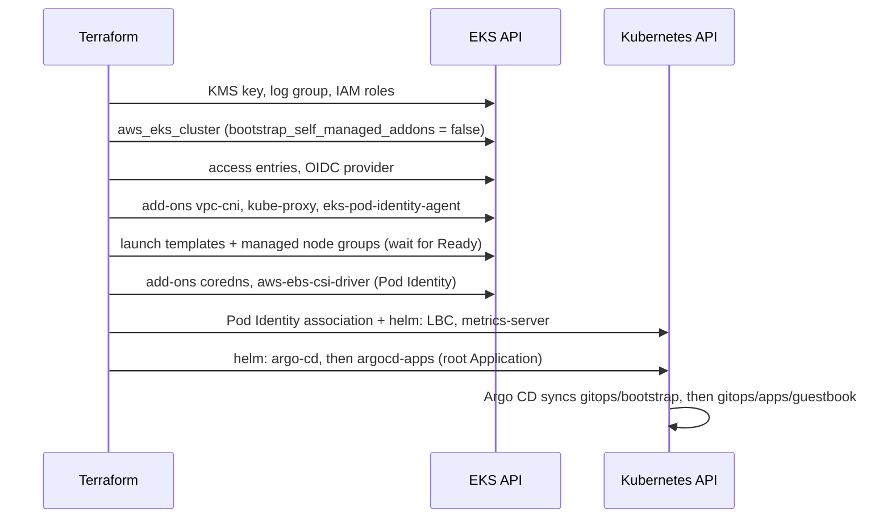

# Architecture

## Layers

Terraform owns everything up to and including Argo CD. From that point on, Argo CD owns
workloads: nothing in `gitops/` is applied by Terraform. This keeps the Terraform state
small and makes application changes a Git commit rather than a `terraform apply`.

## Creation order on a fresh account

## Decisions (ADR style)

### ADR-001: Raw resources instead of terraform-aws-modules/eks
- **Context:** The community module is excellent but hides hundreds of settings behind defaults.
- **Decision:** Build the cluster from `aws_eks_*`, `aws_launch_template` and IAM resources.
- **Consequences:** Every control is visible and unit-tested; upgrades of EKS features need hand-written changes.

### ADR-002: Access entries with authentication mode API
- **Context:** The `aws-auth` ConfigMap can be edited with kubectl and silently drift from IAM.
- **Decision:** `authentication_mode = "API"`; admins come from `admin_principal_arns`.
- **Consequences:** Managed node groups get their access entry automatically; self-managed nodes would need an `EC2_LINUX` entry.

### ADR-003: Pod Identity first, IRSA available
- **Context:** IRSA needs an OIDC trust policy per role and per cluster.
- **Decision:** EBS CSI and the Load Balancer Controller use `pods.eks.amazonaws.com` roles bound with Pod Identity associations. The OIDC provider is still created for charts that only support IRSA.
- **Consequences:** The `eks-pod-identity-agent` add-on must be running before those pods start; this is encoded with `depends_on`.

### ADR-004: Managed add-ons replace the self-managed defaults
- **Context:** EKS installs unmanaged vpc-cni, kube-proxy and CoreDNS unless told not to.
- **Decision:** `bootstrap_self_managed_addons = false` and install all three as EKS add-ons with `resolve_conflicts = OVERWRITE`.
- **Consequences:** Node groups depend on the networking add-ons; CoreDNS depends on node groups.

### ADR-005: GitOps bootstrap with the argocd-apps chart
- **Context:** `kubernetes_manifest` needs the Application CRD to exist at plan time, which fails on a fresh cluster.
- **Decision:** Create the root Application through the `argocd-apps` Helm chart, which is only rendered at apply.
- **Consequences:** The root Application definition lives in Helm values in Terraform; child Applications live in Git.

### ADR-006: Single root module in the example, split state in production
- **Context:** Providers configured from resources that do not exist yet cannot plan cleanly.
- **Decision:** Keep one root for readability and tests; document a targeted first apply. Production splits cluster and add-ons into two states.
- **Consequences:** A careless change in the single root could plan cluster and Helm changes together.

## Subnet maths

| Subnet | Expression | Result on 10.0.0.0/16 |
|---|---|---|
| private[i] | `cidrsubnet(vpc_cidr, 4, i)` | 10.0.0.0/20, 10.0.16.0/20, 10.0.32.0/20 |
| public[i] | `cidrsubnet(vpc_cidr, 8, 48 + i)` | 10.0.48.0/24, 10.0.49.0/24, 10.0.50.0/24 |

Private subnets are large because the VPC CNI gives every pod a VPC IP.
